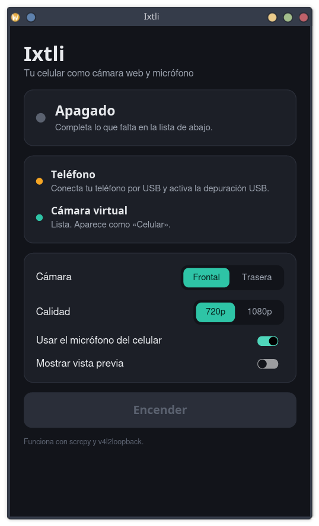

# Ixtli

Use your Android phone as a **webcam and microphone** on Linux, with one click.

[Español](README.md)

*Ixtli* means "face" or "eye" in Nahuatl.

Ixtli does not reinvent anything: it automates [scrcpy](https://github.com/Genymobile/scrcpy),
[v4l2loopback](https://github.com/umlaeute/v4l2loopback) and PipeWire/PulseAudio, which
normally take several terminal commands to set up. The result is a regular camera and
microphone you can pick in Meet, Zoom, Teams, OBS or any other program.

- No app to install on the phone.
- Front or back camera, in 720p or 1080p.
- Power saving mode (about 480p at 15 frames per second) to use less battery.
- The phone's battery level in the window, with a warning below 20 %.
- Pick another lens (for example the ultra-wide), if the phone allows it.
- Image rotation: automatic (follows the phone), quarter turns, a custom angle and a
  mirror effect.
- Preview inside the window, which can be detached into its own window.
- The phone's microphone as a virtual microphone.
- USB cable or WiFi, even with no cable at all (pairing with a QR code).
- A simple window, or the terminal.

The interface is in Spanish. The button names below are the ones you will see.



## Requirements

- Linux with PipeWire or PulseAudio.
- A phone with **Android 12 or newer**.
- `scrcpy` 3.0 or newer, `adb`, the `v4l2loopback` module and `pactl`.

On Debian 13 or newer:

```bash
sudo apt install scrcpy adb v4l2loopback-dkms pulseaudio-utils
```

Other distributions use similar package names (`scrcpy`, `android-tools`,
`v4l2loopback-dkms`). If one is missing, Ixtli tells you which.

## Prepare the phone (first time only)

1. In **Settings → About phone → Software information**, tap **Build number** 7 times.
2. In **Settings → Developer options**, turn on **USB debugging**.
3. Plug the phone in over USB and accept the **"Allow USB debugging?"** prompt.

## Install

### With the .deb package (Debian and Ubuntu)

Download `ixtli_X.Y.Z_amd64.deb` from the
[Releases](https://github.com/xaw624/ixtli/releases) page and install it:

```bash
sudo apt install ./ixtli_*.deb
```

The package also installs what Ixtli needs and loads the virtual camera at boot, so it
does not ask for your password when you turn the camera on.

On Debian 13, `scrcpy` 3 lives in `trixie-backports` (`contrib` section). If `apt` cannot
find `scrcpy`, enable that repository and install again:

```bash
echo "deb http://deb.debian.org/debian trixie-backports main contrib" | sudo tee /etc/apt/sources.list.d/backports.list
```

```bash
sudo apt update
```

### From source

You need Rust 1.85 or newer (`sudo apt install cargo`).

```bash
git clone https://github.com/xaw624/ixtli.git
cd ixtli
./instalar.sh
```

The script builds Ixtli and installs it for your user only, without sudo: the program
goes to `~/.local/bin/ixtli` and shows up as **Ixtli** in the application menu. To build
the `.deb` yourself, run `./empaquetar.sh`.

## Usage

Open **Ixtli**, connect the phone and press **Encender** (turn on). Then, in your video
call, choose:

- Camera: **Ixtli**
- Microphone: **Micrófono del celular (Ixtli)**

If you built from source, the first time after booting the computer Ixtli asks for your
password to load the virtual camera.

### Rotating the image

**Giro** (rotation) has four buttons:

- **Auto**: Ixtli follows the phone's position. Turn on auto-rotate on the phone and
  keep its screen on.
- **Rotate left** and **rotate right**: a quarter turn each time.
- **Mirror**: flips the image left to right.

**Ángulo** (angle) rotates the image to any angle between -180° and 180°; it applies
when you release the slider.

Every rotation change reopens the camera, and the image cuts out for a couple of
seconds.

### Without a cable (WiFi)

The phone and the computer must be on the **same WiFi network**. There are three ways:

**QR code (never needs a cable):**

1. In the window, next to **WiFi**, press **Vincular con QR** (pair with QR).
2. On the phone open **Developer options → Wireless debugging**, turn it on and tap
   **Pair device with QR code**.
3. Scan the code Ixtli shows **with the scanner that screen opens**, not with the camera
   app (the camera app mistakes it for a WiFi network). It connects in a few seconds.

**6-digit code** (if you cannot scan the QR, or over a VPN): the same card in Ixtli has
a form. On the phone tap **Pair device with pairing code** and type into Ixtli the
address (`IP:port`) and the code it shows. If Ixtli then cannot find the phone on the
network, it asks for the **IP address & port** shown on the Wireless debugging screen
and remembers it. Over a VPN the phone must be inside the VPN too, and you type its VPN
address.

After pairing, Ixtli finds the phone by itself, even if its IP changes, as long as
wireless debugging is on. Some phones turn it off when they restart or change networks:
turn it back on in Settings (no need to pair again).

**With the cable once:**

1. Plug the phone in over USB.
2. In the window, next to **WiFi**, press **Conectar por WiFi** (connect over WiFi).
3. When it says "Ya puedes desconectar el cable" (you can unplug the cable), unplug it
   and press **Encender**.

Ixtli remembers the phone and connects by itself next time. If the camera is on over the
cable and you unplug it, it carries on over WiFi after a short cut. If the network drops,
Ixtli turns the camera off and tells you.

With this method, **restarting the phone** turns its WiFi connection off: plug it in once
and press **Conectar por WiFi** again (or pair it with the QR code). To stop using it
without a cable, press **Olvidar** (forget).

### Preview

While the camera is on, the image shows inside the window. **Desacoplar** (detach) moves
it to its own window that you can move and resize; **Acoplar** (attach), or closing that
window, brings it back.

### From the terminal

```bash
ixtli --encender                   # open the window and turn the camera on
ixtli estado                       # check that everything is ready
ixtli encender                     # turn on; Ctrl+C to turn off
ixtli encender --trasera --1080    # back camera in 1080p
ixtli encender --ahorro            # power saving mode: uses less battery
ixtli lentes                       # list the phone cameras, to use --lente=N
ixtli encender --giro=90           # image rotated 90°
ixtli encender --espejo --angulo=15  # mirror effect and 15° extra
ixtli encender --sin-micro         # camera only
ixtli vista                        # window with the camera image
ixtli medir 15                     # measure battery, CPU and memory for 15 min
ixtli wifi                         # move the USB-connected phone to WiFi
ixtli wifi olvidar                 # stop using the phone without a cable
ixtli vincular                     # pair without a cable, QR code in the terminal
ixtli vincular 192.168.1.50:41875 123456   # pair with the 6-digit code
ixtli --help
```

## How it works

1. `scrcpy` captures the phone's camera over USB or WiFi (with Android's wireless
   debugging or `adb tcpip`) and sends it to a virtual camera created with
   `v4l2loopback`.
2. The phone's microphone audio goes to an internal audio output that does not play on
   the speakers.
3. A virtual microphone takes what arrives at that output, so other programs see it as
   a regular microphone.

Turning off or closing Ixtli closes `scrcpy` and removes the virtual microphone.

## Limitations

- Linux only.
- Over WiFi the image depends on the network: if it stutters, use 720p or the cable.
- If you built from source, the virtual camera is lost when the computer restarts;
  Ixtli loads it again when needed. The `.deb` package loads it at boot.
- In some browsers you have to reload the video call page for the new camera and
  microphone to show up.

## Credits

Ixtli is an interface on top of other projects' work:
[scrcpy](https://github.com/Genymobile/scrcpy) (Genymobile),
[v4l2loopback](https://github.com/umlaeute/v4l2loopback) and
[iced](https://github.com/iced-rs/iced) for the window.

## License

[MIT](LICENSE)
