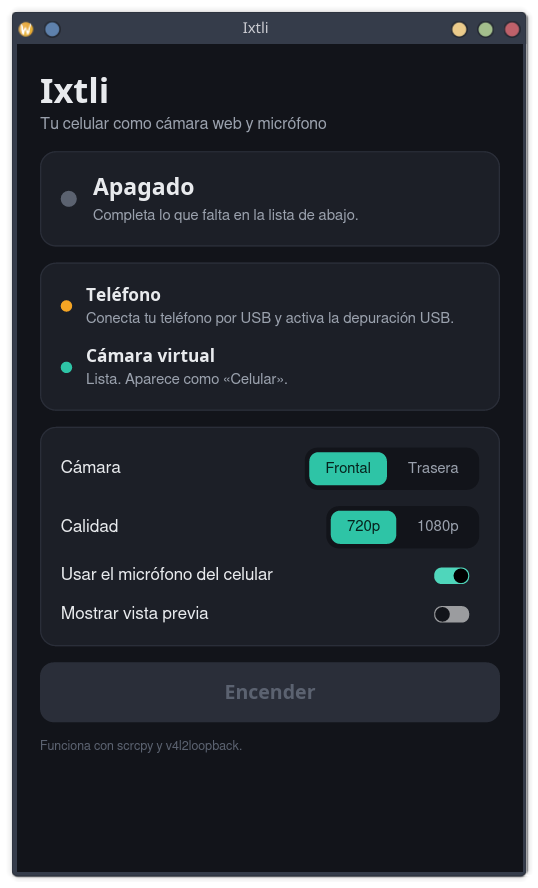

# Ixtli

Usa tu celular Android como **cámara web y micrófono** en Linux, con un clic.

[English](README.en.md)

*Ixtli* significa «rostro» u «ojo» en náhuatl.

Ixtli no reinventa nada: automatiza [scrcpy](https://github.com/Genymobile/scrcpy),
[v4l2loopback](https://github.com/umlaeute/v4l2loopback) y PipeWire/PulseAudio, que
normalmente hay que configurar a mano con varios comandos en la terminal. El resultado
es una cámara y un micrófono normales que puedes elegir en Meet, Zoom, Teams, OBS o
cualquier otro programa.

- No hay que instalar ninguna app en el teléfono.
- Cámara frontal o trasera, en 720p o 1080p.
- Modo ahorro (cerca de 480p y 15 cuadros por segundo) para gastar menos batería.
- Batería del teléfono en la ventana, con un aviso cuando baja de 20 %.
- Elegir otro lente (por ejemplo, el gran angular), si el teléfono lo deja usar.
- La pantalla del teléfono se apaga sola mientras la cámara está encendida, para
  gastar menos batería. Desbloquearlo la vuelve a prender.
- Giro de la imagen: automático según la posición del teléfono, en cuartos de vuelta,
  a un ángulo personalizado y con efecto espejo.
- Vista previa dentro de la ventana, que se puede desacoplar a una ventana aparte.
- Micrófono del teléfono como micrófono virtual.
- Conexión por cable USB o por WiFi, incluso sin cable desde el principio (vinculando con un código QR).
- Ventana sencilla o uso desde la terminal.



## Requisitos

- Linux con PipeWire o PulseAudio.
- Un teléfono con **Android 12 o más nuevo** y un cable USB.
- `scrcpy` 3.0 o más nuevo, `adb`, el módulo `v4l2loopback` y `pactl`.

En Debian 13 o más nuevo:

```bash
sudo apt install scrcpy adb v4l2loopback-dkms pulseaudio-utils
```

En otras distribuciones los paquetes se llaman parecido (`scrcpy`, `android-tools`,
`v4l2loopback-dkms`). Si falta alguno, Ixtli te dice cuál.

## Preparar el teléfono (solo la primera vez)

1. En **Ajustes → Acerca del teléfono → Información de software**, toca 7 veces
   **Número de compilación**.
2. En **Ajustes → Opciones de desarrollador**, activa **Depuración USB**.
3. Conecta el teléfono por USB y acepta el aviso **«¿Permitir depuración USB?»**.

## Instalación

### Con el paquete .deb (Debian y Ubuntu)

Descarga `ixtli_X.Y.Z_amd64.deb` de la página de
[Releases](https://github.com/xaw624/ixtli/releases) e instálalo:

```bash
sudo apt install ./ixtli_*.deb
```

El paquete instala también lo que Ixtli necesita y deja la cámara virtual cargada
desde el arranque, así que no pide contraseña al encender.

En Debian 13, `scrcpy` 3 está en `trixie-backports` (sección `contrib`). Si `apt` dice
que no encuentra `scrcpy`, activa ese repositorio y repite la instalación:

```bash
echo "deb http://deb.debian.org/debian trixie-backports main contrib" | sudo tee /etc/apt/sources.list.d/backports.list
```

```bash
sudo apt update
```

### Compilando

Necesitas Rust 1.85 o más nuevo (`sudo apt install cargo`).

```bash
git clone https://github.com/xaw624/ixtli.git
cd ixtli
./instalar.sh
```

El script compila Ixtli y lo instala solo para tu usuario, sin sudo: el programa queda
en `~/.local/bin/ixtli` y aparece como **Ixtli** en el menú de aplicaciones. Para armar
tú mismo el `.deb`, ejecuta `./empaquetar.sh`.

## Uso

Abre **Ixtli**, conecta el teléfono y presiona **Encender**. Después, en tu
videollamada elige:

- Cámara: **Ixtli**
- Micrófono: **Micrófono del celular (Ixtli)**

La primera vez después de prender la computadora, Ixtli pide tu contraseña para activar
la cámara virtual.

La cámara **Ixtli** siempre tiene el mismo tamaño (el de la calidad elegida). Puedes
cambiar de cámara, de lente, el modo ahorro o el giro en plena llamada: la imagen se
acomoda, con franjas negras si hace falta, y la videollamada no pierde la cámara. Con la
cámara apagada, la videollamada ve negro hasta que la vuelvas a encender. La calidad no
se puede cambiar mientras una videollamada esté usando la cámara: Ixtli te avisa.

También verás una cámara **Ixtli-interna**: es de uso interno, no la elijas.

### Girar la imagen

En **Giro** hay cuatro botones:

- **Auto**: Ixtli sigue la posición del teléfono. Para eso activa el giro automático
  de pantalla en el teléfono.
- **Girar a la izquierda** y **girar a la derecha**: un cuarto de vuelta cada vez.
- **Espejo**: voltea la imagen de izquierda a derecha.

Con **Ángulo** giras la imagen a cualquier ángulo entre -180° y 180°; se aplica al
soltar el control.

Cada vez que cambia el giro, la cámara se reabre y la imagen se corta un par de
segundos.

### Sin cable (WiFi)

El teléfono y la computadora deben estar en la **misma red WiFi**. Hay tres formas:

**Con código QR (sin cable nunca):**

1. En la ventana, junto a **WiFi**, presiona **Vincular con QR**.
2. En el teléfono abre **Opciones de desarrollador → Depuración inalámbrica**, actívala y
   toca **Vincular dispositivo con código QR**.
3. Escanea el código que muestra Ixtli **con el lector que abre esa pantalla**, no con
   la app de cámara (la cámara lo confunde con una red WiFi). En unos segundos queda
   conectado.

**Con el código de 6 dígitos** (si no puedes escanear el QR, o por VPN): en la misma
tarjeta de Ixtli hay un formulario. En el teléfono toca **Vincular dispositivo con
código de vinculación** y escribe en Ixtli la dirección (`IP:puerto`) y el código que
muestra. Si después Ixtli no encuentra el teléfono en la red, te pide la **Dirección IP
y puerto** de la pantalla de Depuración inalámbrica y la recuerda. Por VPN, el teléfono
también debe estar dentro de la VPN y se escribe su IP de la VPN.

Después Ixtli encuentra el teléfono solo, aunque cambie su IP, mientras la depuración
inalámbrica esté encendida. Algunos teléfonos la apagan al reiniciarse o al cambiar de
red: vuelve a activarla en Ajustes (no hace falta vincular otra vez).

**Con el cable una vez:**

1. Conecta el teléfono por USB.
2. En la ventana, junto a **WiFi**, presiona **Conectar por WiFi**.
3. Cuando diga «Ya puedes desconectar el cable», desconéctalo y presiona **Encender**.

Ixtli recuerda el teléfono y la siguiente vez se conecta solo, sin cable. Si la cámara
está encendida por cable y lo desconectas, sigue por WiFi tras un corte de un par de
segundos. Si se cae la red, Ixtli apaga la cámara y te avisa.

Con este método, al **reiniciar el teléfono** se apaga su conexión por WiFi: conéctalo por
USB una vez y vuelve a presionar **Conectar por WiFi** (o vincúlalo con QR). Para dejar
de usarlo sin cable, presiona **Olvidar**.

### Vista previa

Con la cámara encendida, la imagen aparece dentro de la ventana. **Desacoplar** la pasa
a una ventana aparte que puedes mover y cambiar de tamaño; **Acoplar** (o cerrar esa
ventana) la regresa.

### Desde la terminal

```bash
ixtli --encender                   # abre la ventana y enciende de una vez
ixtli estado                       # revisa si todo está listo
ixtli encender                     # enciende; Ctrl+C para apagar
ixtli encender --trasera --1080    # cámara trasera en 1080p
ixtli encender --ahorro            # modo ahorro: gasta menos batería
ixtli lentes                       # cámaras del teléfono, para usar --lente=N
ixtli encender --pantalla-prendida # no apaga la pantalla del teléfono
ixtli encender --giro=90           # imagen girada 90°
ixtli encender --espejo --angulo=15  # efecto espejo y 15° extra
ixtli encender --sin-micro         # solo la cámara
ixtli vista                        # ventana con la imagen de la cámara
ixtli medir 15                     # mide 15 min de batería, CPU y memoria
ixtli wifi                         # pasa a WiFi el teléfono conectado por USB
ixtli wifi olvidar                 # deja de usar el teléfono sin cable
ixtli vincular                     # vincula sin cable con un código QR en la terminal
ixtli vincular 192.168.1.50:41875 123456   # vincula con el código de 6 dígitos
ixtli --help
```

## Cómo funciona

1. `scrcpy` captura la cámara del teléfono por USB o por WiFi (con la depuración
   inalámbrica de Android o con `adb tcpip`) y la envía a una cámara virtual interna
   creada con `v4l2loopback`.
2. Ixtli copia esa imagen a la cámara **Ixtli**, siempre del mismo tamaño, y manda
   negro cuando la cámara está apagada.
3. El audio del micrófono del teléfono se envía a una salida de audio interna que no
   suena en las bocinas.
4. Un micrófono virtual toma lo que llega a esa salida, y así los demás programas lo
   ven como un micrófono normal.

Al apagar o cerrar Ixtli se cierra `scrcpy` y se quita el micrófono virtual.

## Limitaciones

- Solo Linux.
- Por WiFi la imagen depende de la red: si se traba, usa 720p o el cable.
- La cámara virtual se pierde al reiniciar la computadora; Ixtli la vuelve a activar
  cuando hace falta.
- En algunos navegadores hay que recargar la página de la videollamada para que
  aparezcan la cámara y el micrófono nuevos.
- Si actualizas desde la versión 0.2, Ixtli te pide actualizar la cámara virtual una
  vez (con tu contraseña y las videollamadas cerradas), o se actualiza sola al
  reiniciar la computadora.

## Créditos

Ixtli es una interfaz sobre el trabajo de otros proyectos:
[scrcpy](https://github.com/Genymobile/scrcpy) (Genymobile),
[v4l2loopback](https://github.com/umlaeute/v4l2loopback) y
[iced](https://github.com/iced-rs/iced) para la ventana.

## Licencia

[MIT](LICENSE)
